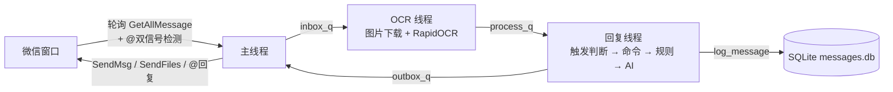

<div align="center">

# 🤖 WeChat-Keyword-Bot

**基于 wxauto 的 Windows 微信群聊机器人**

`白名单监听` · `@ 识别` · `命令插件` · `关键词规则` · `AI 兜底` · `图片 OCR` · `AI 画图` · `SQLite 日志`


</div>

---

## 📖 目录

- [功能特性](#-功能特性)
- [环境要求](#️-环境要求)
- [快速上手（5 分钟跑通）](#-快速上手5-分钟跑通)
- [配置详解](#️-配置详解)
- [消息触发规则](#-消息触发规则)
- [内置命令一览](#-内置命令一览)
- [扩展自己的命令](#-扩展自己的命令)
- [工作原理](#️-工作原理)
- [目录结构](#-目录结构)
- [消息日志查询](#-消息日志查询)
- [常见问题](#-常见问题)
- [免责声明](#-免责声明)

## ✨ 功能特性

- **白名单机制** —— 只监听配置里的群聊 / 好友，其他会话完全忽略
- **群聊触发机制** —— 不是每条都回：只有 `@我` / 含触发词 / `#命令` 才回复，防刷屏限速，表现得像一个正常的群成员
- **@ 识别双信号** —— 文本规范化匹配（处理 U+2005 等特殊空白字符、短昵称边界防误判）+ UIA 子控件检测（微信原生 @ 元素）；`@小明哥` 不会被误判成 `@小明`
- **命令插件框架** —— `commands/` 目录即插即用，`#帮助` 菜单从注册表自动生成，新增一条命令只需 3 行代码
- **关键词规则** —— 口语化触发（「在吗」「几点了」），支持 `keyword` 子串 / `regex` 正则，回复模板支持占位符
- **AI 兜底回复** —— 触发但未命中规则时走 JEV 决策 + DeepSeek 拟人回复，被 @ 时强制回复、闲聊时智能门控
- **图片 OCR** —— 群图片自动下载 → RapidOCR **离线**识别中文 → 以 `[图片] 识别文字` 参与触发与回复，识别失败自动降级
- **AI 画图** —— `#画图` 默认走 Pollinations.ai 免费接口（零配置免 Key），可选智谱 CogView 升级画质
- **三队列 + 双线程架构** —— 主线程只做 wxauto UI 操作，OCR / AI / 画图全在后台线程，**微信窗口永不卡死**
- **历史预热** —— 启动时把窗口里已有的消息全部标记忽略，只响应启动后的新消息，重跑不误报
- **SQLite 日志** —— 每条消息（含机器人自己的回复与命中规则）全部落库，可追溯

## 🖥️ 环境要求

| 项目 | 要求 |
|------|------|
| 操作系统 | Windows 10 / 11 |
| 微信客户端 | **3.9.12.1000**（⚠️ 不支持微信 4.x，4.x 请改用 wxauto4 项目） |
| Python | 3.10 及以上（开发环境 3.12） |
| 运行条件 | 微信保持登录、窗口可操作（UI 自动化原理，不要最小化到托盘） |

> 微信 3.9.12.1000 历史版本可在官网或可信镜像下载，安装后**关闭自动更新**。

## 🚀 快速上手（5 分钟跑通）

### Step 1 · 克隆并安装依赖

```bash
git clone https://github.com/wjjiuci/WeChat-Keyword-Bot.git
cd WeChat-Keyword-Bot
pip install -r requirements.txt
```

### Step 2 · 生成配置

```bash
# 复制模板为本地配置（config.py 已被 .gitignore 排除，不会上传）
cp config.example.py config.py      # Windows PowerShell 用: copy config.example.py config.py
```

编辑 `config.py`，**最少只改两处**：

```python
WHITELIST = ["你的群名"]          # 要监听的群
SELF_NICKNAME = "你的微信昵称"    # 用于识别群里的 @你
```

### Step 3 · 启动

```bash
python bot.py
```

看到下面这样就是跑起来了：

```text
正在连接微信...
初始化成功，获取到已登录窗口：xxx
微信连接成功
白名单：['你的群名']
触发模式：at_or_kw  |  触发词：['机器人', '小助手', 'bot']
防刷屏间隔：5.0s  |  @回复：开
指令插件：7 个  |  关键词规则：5 条  |  AI：开  |  OCR：开  |  画图：免费接口
------------------------------------------------------------
  [你的群名] 已忽略 10 条历史消息，只响应启动后的新消息
------------------------------------------------------------
```

### Step 4 · 到群里验证

按顺序发这几条，检查机器人反应：

| 你发 | 机器人应该 |
|------|-----------|
| `#帮助` | 弹出指令菜单 |
| `@机器人昵称 时间` | 回「现在是 HH:MM」 |
| `机器人 #骰子` | 回骰子点数 |
| 随便说句与机器人无关的话 | **沉默**（只记录不回复） |

✅ 四条全部符合 → 部署完成。可选功能（AI 兜底 / 智谱画图）见下一节。

## ⚙️ 配置详解

所有配置集中在 `config.py`（模板见 [config.example.py](config.example.py)）。

### 基础

| 配置项 | 类型 | 说明 | 默认值 |
|--------|------|------|--------|
| `WHITELIST` | `list` | 要监听的群名 / 好友昵称，可填多个 | `["示例群名1"]` |
| `SELF_NICKNAME` | `str`/`list` | 机器人自己的微信昵称，用于识别 @我；有群昵称可填列表 `["昵称1", "昵称2"]` | `"我"` |
| `POLL_INTERVAL` | `float` | 轮询消息间隔（秒），越小响应越快、UI 占用越高 | `2.0` |

### 群聊触发

| 配置项 | 类型 | 说明 | 默认值 |
|--------|------|------|--------|
| `TRIGGER_MODE` | `str` | `"at"`=仅@我回复 / `"keyword"`=仅触发词 / `"at_or_kw"`=二者皆可 | `"at_or_kw"` |
| `GROUP_TRIGGER_KEYWORDS` | `list` | 召唤词；**@我自动识别，不要写在这里** | `["机器人", "小助手", "bot"]` |
| `GROUP_REPLY_INTERVAL` | `float` | 同群两次回复最小间隔（秒），防刷屏 | `5.0` |
| `REPLY_WITH_AT` | `bool` | 群聊回复时是否 @ 对方 | `True` |
| `EMPTY_AT_REPLY` | `str` | 只 @ 我没说话时的固定回复；`""` 则沉默 | `"在的，说啥？"` |

### 回复规则

| 配置项 | 说明 |
|--------|------|
| `RULES` | 非命令式关键词规则列表。每条：`match`（匹配内容）、`reply`（回复模板，支持 `{time} {sender} {chat} {content} {joke}` 占位符）、`mode`（`keyword` 子串包含 / `regex` 正则）、`case_sensitive`（可选）。**按顺序匹配，命中第一条即停**。注意 `#` 开头的请写进 commands/ 插件，不要放这里 |
| `JOKES` | 笑话库，`#笑话` 命令与 `{joke}` 占位符共用 |
| `ENABLE_AI_REPLY` | 触发但未命中任何规则时是否调用 AI 兜底（默认 `True`，需配置见下文） |
| `OCR_ENABLED` | 是否开启图片 OCR 识别 |

### AI 画图

| 配置项 | 说明 | 默认值 |
|--------|------|--------|
| `ZHIPU_API_KEY` | 智谱 API Key（[bigmodel.cn](https://bigmodel.cn) 申请，0.06 元/次）；**留空则自动走 Pollinations.ai 免费接口，零配置可用** | `""` |
| `IMAGE_GEN_MODEL` | 智谱模型（填了 Key 才生效）：`cogview-3-flash` / `cogview-4` | `"cogview-3-flash"` |
| `IMAGE_GEN_SIZE` | 图片尺寸 `宽x高`，如 `1024x1024`、`1024x576` | `"1024x1024"` |
| `IMAGE_GEN_TIMEOUT` | 生成 / 下载超时（秒） | `90` |

### AI 兜底回复（可选，进阶）

`ENABLE_AI_REPLY = True` 时，[ai_reply.py](ai_reply.py) 的行为：

```text
消息触发 → JEV 决策模型（情绪/意图/should_reply 门控）
              ├─ 判定不适合回复 → 沉默（被 @ 时跳过门控，强制回复）
              └─ 判定适合 → DeepSeek 生成拟人回复
                              └─ DeepSeek 失败 → 本地 BERT 情感模型兜底
```

它从**同级目录**的 `../WeChat-Auto-Reply-System-main/config.py` 读取
JEV / DeepSeek 的 API Key、人设（PERSONA）、关系（RELATIONSHIP）等配置，二者配套使用：

- **没有原项目？** 把 `ENABLE_AI_REPLY` 改成 `False`——命令、关键词、OCR、画图全部正常，只是无 AI 聊天
- **有原项目？** 到 `WeChat-Auto-Reply-System-main/config.py` 里填好 JEV_API_KEY 与 DEEPSEEK_API_KEY，并按需修改 PERSONA / RELATIONSHIP（机器人性格与与群友的关系定位）

## 💬 消息触发规则

一条群消息到达后，机器人的完整判断流程：

```text
群消息
 ├─ 在防刷屏间隔内？ ── 是 → 只记录，不回复
 ├─ 群聊触发判断（TRIGGER_MODE）：
 │     @我（文本 + UIA 双信号）／ 含触发词 ／ 以 # 开头
 │     └─ 都不满足 → 只记录，不回复
 ├─ 0) 只 @ 我没说话            → 回 EMPTY_AT_REPLY
 ├─ 1) #命令 / @我+命令名       → 命令插件处理（未知命令回提示，不进 AI）
 ├─ 2) 命中 RULES 关键词        → 按模板回复
 └─ 3) 都没命中                 → AI 兜底（可关闭）
```

私聊（在白名单内的好友）**始终回复**，不受触发条件与防刷屏限制。

## 🧩 内置命令一览

| 命令 | 别名 | 示例 | 说明 |
|------|------|------|------|
| `#帮助` | `help` `功能` `菜单` `menu` | `#帮助` | 动态指令菜单（自动收录所有命令） |
| `#时间` | `几点` `now` `time` | `#时间` / `@机器人 几点了` | 报当前时间 |
| `#天气` | `weather` `tianqi` `查天气` | `#天气 北京` / `#天气北京` / `@机器人 查天气 上海` | 实时天气（温度/湿度/风），自动重试 3 次 |
| `#笑话` | `joke` `讲个笑话` | `#笑话` | 从 JOKES 库随机一条 |
| `#骰子` | `dice` `色子` `摇骰子` | `#骰子` | 掷骰子 1-6 点 |
| `#抽签` | `choose` `选一个` `选择困难` | `#抽签 吃饭 吃面` / `#抽签` | 有选项帮你拍板，没选项测今日加权签运 |
| `#画图` | `画画` `绘画` `draw` | `#画图 一只在月球上的柴犬` / `#画图柴犬` | AI 画图：先回提示，后台生成 5~30 秒，画好自动发群 |

所有命令支持三种写法：`#命令`、`@机器人 命令`、`@机器人 #命令`；天气 / 画图额外支持**命令与参数连写**（`#天气北京`）。
发送未注册的 `#xxx` 会收到引导提示：`没这个指令，发 #帮助 看看我都会啥~`

## 🔌 扩展自己的命令

在 `commands/` 下任意插件文件加一个函数，再到 `commands/__init__.py` import 该模块即可：

```python
from .base import command

@command("打脸", aliases=("pa",), help="#打脸 - 拍一下")
def cmd_slap(ctx):
    return f"啪！{ctx.sender} 被打了一巴掌"
```

保存后重启，`#帮助` 菜单自动收录，无需改 bot.py。

`Context` 对象字段：

| 字段 | 说明 |
|------|------|
| `ctx.chat` | 群名 / 私聊对象名 |
| `ctx.sender` | 发送者昵称 |
| `ctx.content` | 清洗 @ 前缀后的完整消息文本 |
| `ctx.arg` | 命令名之后的参数原文（`#天气 北京` → `"北京"`） |
| `ctx.is_group` | 是否群聊 |
| `ctx.deliver_text(text)` | 异步追加发一条文本（后台任务完成后投递） |
| `ctx.deliver_image(path, caption)` | 异步发送本地图片，主线程通过 wxauto 发出并自动清理 |

需要耗时操作（网络请求、生成任务）的命令参考 [commands/draw.py](commands/draw.py)：命令函数**立刻返回提示**，把耗时工作丢进后台线程，完成后用 `deliver_*` 回调投递结果。

## ⚙️ 工作原理

三队列 + 双线程，主线程零阻塞：



- **主线程**：wxauto 轮询收消息（趁 UIA 控件有效做 @ 检测）→ 入队；出箱 → 发文本 / 发图
- **OCR 线程**：图片下载与识别等重计算，其余消息直接透传
- **回复线程**：触发判断、命令分发、规则匹配、AI 调用（网络 I/O）
- **历史预热**：启动时先拉一遍窗口内已有消息记入基线集合，永不裁剪，防止旧消息“复活”误报

## 📁 目录结构

```text
WeChat-Keyword-Bot/
├── bot.py                 # 主程序：轮询 / 队列调度 / 发送
├── config.py              # 本地真实配置（gitignore，不上传）
├── config.example.py      # 配置模板
├── matcher.py             # 关键词 / 正则匹配引擎
├── ai_reply.py            # AI 兜底：JEV 决策 + DeepSeek + BERT
├── ocr.py                 # 图片下载 + RapidOCR 识别
├── image_gen.py           # 文生图：Pollinations 免费接口 / 智谱 CogView
├── database.py            # SQLite 消息日志（WAL）
├── requirements.txt
├── .gitignore
└── commands/              # 命令插件包（import 即注册）
    ├── __init__.py        # 在这里注册新插件模块
    ├── base.py            # @command 装饰器 / Context / dispatch
    ├── system.py          # 时间、帮助
    ├── fun.py             # 笑话、骰子、抽签
    ├── weather.py         # 天气（重试 / 连写）
    └── draw.py            # 画图（异步生成 + 图片投递）
```

## 🗄️ 消息日志查询

所有消息存在本地 `messages.db`（WAL 模式），表结构：

| 字段 | 说明 |
|------|------|
| `received_at` | 消息时间 |
| `chat_name` | 所在群 / 聊天 |
| `sender` | 发送人（机器人自己 `is_self=1`） |
| `content` | 消息内容（图片为 `[图片] 识别文字`） |
| `matched_rule` / `reply` / `replied_at` | 命中的规则与机器人的回复 |

用任意 SQLite 工具查看，或命令行：

```bash
sqlite3 messages.db "SELECT received_at, sender, content, reply FROM messages ORDER BY id DESC LIMIT 20;"
```

## ❓ 常见问题

**Q：提示“未找到微信窗口”？**
微信版本必须是 3.9.12.1000 且已登录。4.x 界面架构不同，本项目不兼容。

**Q：偶尔 COMError / UIA 报错？**
微信窗口被遮挡或正在加载导致控件失效，程序会自动重试。频繁出现就保持微信窗口前台可见、关闭全屏模式。

**Q：群里发消息机器人没反应？**
按顺序排查：① 群名在 `WHITELIST` 里且一字不差 ② 消息满足触发条件（@我 / 触发词 / #命令）③ 不在其他回复的 5 秒防刷屏间隔内 ④ `SELF_NICKNAME` 与你在群里的实际昵称一致（@ 识别靠它）

**Q：启动后回复了旧消息？**
正常情况下历史预热会忽略启动前的消息。若仍复现请提 issue。

**Q：AI 兜底从来不回？**
① 确认 `ENABLE_AI_REPLY = True` ② 确认 `../WeChat-Auto-Reply-System-main/config.py` 里两个 Key 配好且有效 ③ JEV 有回复门控，普通闲聊判定“不适合回复”会沉默，被 @ 一定会回

**Q：画图慢或偶尔失败？**
免费接口偶发排队 / 断连（已自动重试 3 次），超时设了 90 秒。对画质与中文出图有要求，配置 `ZHIPU_API_KEY` 切换 CogView。

**Q：OCR 装不上？**
`rapidocr-onnxruntime` 纯 pip 安装、离线可用；国内网络可加 `-i https://pypi.tuna.tsinghua.edu.cn/simple`。OCR 加载失败不影响其他功能，图片按 `[图片]` 占位处理。

## ⚠️ 免责声明

本项目仅供学习交流，基于 UI 自动化实现，存在被微信检测限制的可能，请自行评估风险。
请勿用于骚扰、广告或其他违反微信使用规范的行为；使用本项目产生的任何后果由使用者自行承担。

---

<div align="center">

**觉得有用的话，点个 ⭐ Star 支持一下～**

</div>
